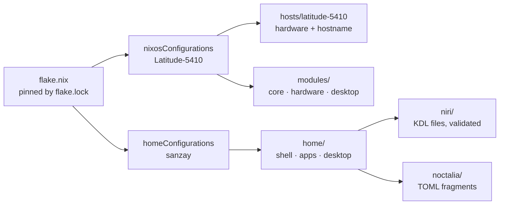

<div align="center">

# ❄️ Latitude-5410

**A modular NixOS + standalone Home Manager flake for a Dell Latitude 5410**
Niri · Noctalia · Firefox · fully declarative, reproducible from a bare disk


</div>

---

## 📖 Contents

- [The machine](#-the-machine)
- [The pattern](#-the-pattern)
- [Layout](#-layout)
- [Daily usage](#-daily-usage)
- [Reproducing from scratch](#-reproducing-from-scratch)
- [Hardware notes and gotchas](#-hardware-notes-and-gotchas)
- [What is not reproducible](#-what-is-not-reproducible)
- [Rollback and recovery](#-rollback-and-recovery)
- [Cheat sheet](#-cheat-sheet)

---

## 💻 The machine

| | |
|---|---|
| **Model** | Dell Latitude 5410 |
| **CPU** | Intel Core i5, 10th gen (Comet Lake) |
| **GPU** | Intel UHD Graphics (integrated, `iHD` VA-API driver) |
| **RAM** | 8 GB (tuned: zram + swapfile + earlyoom) |
| **Display** | 1920x1080 internal panel (`eDP-1`), 1.33x fractional scale |
| **Storage** | SSD, UEFI, three ext4/vfat partitions: `/boot`, `/`, `/home` |
| **Boot** | systemd-boot, dual-boot with Windows |
| **Host name** | `Latitude-5410` |
| **User** | `sanzay` |

---

## 🧩 The pattern

Three ideas keep this config easy to live with.

**1. One flake, two independent outputs.**
NixOS (the system) and Home Manager (the user environment) are built **separately** from the same flake and the same pinned inputs.

| Output | Command | Needs sudo | Use it for |
|---|---|---|---|
| `nixosConfigurations."Latitude-5410"` | `rebuild` | yes | drivers, services, boot, fonts, system packages |
| `homeConfigurations.sanzay` | `hm` | **no** | niri, Noctalia, shell, Firefox, apps |

Most day-to-day tweaking happens in `home/`, so `hm` is the command you will use most. It is quick and never touches the system.

**2. Stable base, unstable where it matters.**
`nixpkgs` follows `nixos-26.05`. An overlay exposes `pkgs.unstable.*`, used for the fast-moving desktop pieces (`niri`, `noctalia`). Everything else stays on stable.

**3. Config files stay in their native format.**
Instead of re-expressing everything in Nix, the real files live in the repo and Nix just installs them:

- **Niri:** `config.kdl` plus `cfg/*.kdl`, split by topic (keybinds, layout, rules...). They are **validated at build time** with `niri validate`, so a typo fails `hm` instead of breaking your next login.
- **Noctalia:** one small `.toml` per section. Nix concatenates them into a single `noctalia-config.toml`, so you edit `bar.toml` and not a 400-line file.
- **Starship:** a plain `starship.toml`.



---

## 🗂 Layout

```text
.
├── flake.nix                      inputs, overlay, the two outputs
├── flake.lock                     exact pinned versions (this is your reproducibility)
├── hosts/
│   └── latitude-5410/
│       ├── default.nix            hostname, stateVersion, imports modules/
│       └── hardware-configuration.nix   generated per machine (see below)
├── modules/                       system-level (NixOS)
│   ├── core/                      boot, nix (+nh), locale, users, networking
│   ├── hardware/                  graphics, intel, memory, audio, laptop
│   └── desktop/                   fonts, fcitx5, niri, greeter, common plumbing
└── home/                          user-level (Home Manager)
    ├── shell/                     bash + aliases, starship, git, fastfetch
    ├── apps/                      packages, firefox, mimeapps
    └── desktop/
        ├── niri/                  config.nix, appearance.nix, config.kdl, cfg/*.kdl
        └── noctalia/              default.nix + one .toml per section
```

**Where do I change...?**

| I want to... | Edit | Then run |
|---|---|---|
| Add a keybind | `home/desktop/niri/cfg/keybinds.kdl` | `hm` |
| Change gaps, borders, shadows | `home/desktop/niri/cfg/layout.kdl` | `hm` |
| Change the monitor mode or scale | `home/desktop/niri/cfg/display.kdl` | `hm` |
| Tweak the bar or lock screen | `home/desktop/noctalia/*.toml` | `hm` |
| Install a desktop app | `home/apps/packages.nix` | `hm` |
| Change Firefox policies | `home/apps/firefox.nix` | `hm` |
| Change default apps | `home/apps/mimeapps.nix` | `hm` |
| Add a system service or package | `modules/...` | `rebuild` |
| Change swap or memory tuning | `modules/hardware/memory.nix` | `rebuild` |

---

## 🚀 Daily usage

The flake lives in **`/etc/nixos`**, and `programs.nh.flake` points there, so these work from any directory.

| Alias | Runs | Purpose |
|---|---|---|
| `rebuild` | `nh os switch` | build and activate the system |
| `rebuild-boot` | `nh os boot` | activate on next boot only |
| `rebuild-test` | `nh os test` | activate now, no boot entry |
| `hm` | `nh home switch -b backup -c sanzay` | build and activate the user environment |

```bash
cd /etc/nixos
$EDITOR home/desktop/niri/cfg/keybinds.kdl
hm                       # niri reloads its config automatically
```

> **New files need `git add`.** Flakes only see files tracked by git. If you create or rename a file and get a "path does not exist" error, run `git add <file>` and try again. Editing existing files needs nothing. Commits are optional for builds, but good restore points.

**Updating everything**

```bash
cd /etc/nixos
nix flake update          # bump all inputs (or: nix flake update nixpkgs)
rebuild && hm
git add -A && git commit -m "flake: update inputs"
```

**Cleanup** is automatic: `nh clean` runs weekly and keeps generations from the last 7 days plus at least the 3 newest. `nix.optimise` deduplicates the store weekly.

---

## 🔁 Reproducing from scratch

The goal: a blank disk to this exact desktop with a handful of commands.

### What makes it reproducible

- **`flake.lock`** pins nixpkgs, unstable, Home Manager and the greeter to exact commits. Same lock means same packages.
- **Everything is in git:** system, user config, keybinds, bar layout, Firefox policies and extensions.
- **The only per-machine file** is `hosts/latitude-5410/hardware-configuration.nix`.

### Fresh install (same laptop, wiped disk)

1. **Boot the NixOS installer** (graphical or minimal ISO, UEFI mode) and get online (`nmcli` or `nmtui`).

2. **Partition and mount.** The layout this config was built on is a vfat EFI partition at `/boot`, ext4 at `/`, and a separate ext4 at `/home`:
   ```bash
   mount /dev/disk/by-label/nixos /mnt
   mkdir -p /mnt/boot /mnt/home
   mount /dev/<efi-partition>  /mnt/boot
   mount /dev/<home-partition> /mnt/home
   ```
   If Windows shares the disk, **reuse its existing EFI partition** and do not format it.

3. **Create the swapfile** (the config expects `/swapfile`; see [Swapfile](#swapfile)):
   ```bash
   mkswap -U clear --size 4G --file /mnt/swapfile
   ```

4. **Get the config and regenerate the hardware file:**
   ```bash
   nix-shell -p git
   git clone https://github.com/sanjayawosti/Nixos.git /mnt/etc/nixos
   nixos-generate-config --root /mnt --show-hardware-config \
     > /mnt/etc/nixos/hosts/latitude-5410/hardware-configuration.nix
   git -C /mnt/etc/nixos add -A
   ```
   New disk UUIDs go into that generated file. Nothing else needs editing.

5. **Install:**
   ```bash
   nixos-install --flake /mnt/etc/nixos#Latitude-5410
   ```
   It will ask for a root password.

6. **Set your user password** (the config declares the user but no password):
   ```bash
   nixos-enter --root /mnt -c 'passwd sanzay'
   ```

7. **Reboot, log in, and take ownership of the repo:**
   ```bash
   sudo chown -R sanzay: /etc/nixos
   ```

8. **First Home Manager activation** (`nh` and the aliases do not exist in your shell yet):
   ```bash
   cd /etc/nixos
   nix run home-manager -- switch --flake .#sanzay -b backup
   ```
   From now on, `hm` and `rebuild` just work.

9. **Restore the non-declarative bits:** wallpapers into `~/Pictures/Wallpapers/`, sign in to Bitwarden, and let Noctalia generate its theme on first launch. See [What is not reproducible](#-what-is-not-reproducible).

### On a different machine

Copy `hosts/latitude-5410/` to `hosts/<new-name>/`, regenerate its `hardware-configuration.nix`, set the hostname, add a `nixosConfigurations."<new-name>"` entry in `flake.nix`, then review the files in the next section.

### Without reinstalling (existing NixOS)

```bash
git clone https://github.com/sanjayawosti/Nixos.git /etc/nixos
cd /etc/nixos
# replace hosts/latitude-5410/hardware-configuration.nix with this machine's
sudo nixos-rebuild switch --flake .#Latitude-5410
nix run home-manager -- switch --flake .#sanzay -b backup
```

---

## 🔧 Hardware notes and gotchas

These are the places where this config is tied to this specific laptop. Check them first on any other machine.

### `hardware-configuration.nix` is machine-specific
It contains the **disk UUIDs**, the kernel modules for this chipset (`xhci_pci`, `ahci`, `rtsx_pci_sdmmc` for the card reader) and the microcode setting. After any reinstall or disk change, **regenerate it** with `nixos-generate-config`. Never copy an old one onto new partitions.

### Separate `/home` partition
`/home` is its own partition. On a reinstall, **mount it, do not format it**, and your data survives. The flip side: the generated hardware file must reference the correct UUID for it.

### Swapfile
`modules/hardware/memory.nix` declares `/swapfile` but **does not create it**. If the file is missing, boot logs a failed swap unit (harmless but noisy). Create it once:
```bash
sudo mkswap -U clear --size 4G --file /swapfile
```
Or let NixOS manage it by adding `size = 4096;` (in MB) to the `swapDevices` entry.

### 8 GB RAM tuning
| Setting | Why |
|---|---|
| `zramSwap` (zstd, 50%) | compressed swap in RAM is faster than disk and used first |
| `/swapfile` at priority 0 | overflow only, lower priority than zram |
| `vm.swappiness = 100`, `vm.page-cluster = 0` | correct values when swap is zram-first |
| `earlyoom` + notifications | kills the worst offender instead of freezing the desktop |
| `nix.settings.max-jobs = 2`, `cores = 4` | big builds will not exhaust memory |
| Nix daemon at idle CPU/IO priority | rebuilds do not make the desktop lag |

If a build still gets killed, lower `max-jobs` to 1.

### Windows dual boot
- `time.hardwareClockInLocalTime = true` stops Windows and Linux fighting over the clock.
- `boot.loader.timeout = 0` boots straight into NixOS. **Hold `Space` while powering on** to reach the boot menu and pick Windows.
- `configurationLimit = 4` keeps the ESP from filling with old generations. Windows shares that partition, so keep it small.

### Intel graphics and CPU
- `intel-media-driver` with `LIBVA_DRIVER_NAME=iHD` gives hardware video decode on Comet Lake.
- `thermald` and Intel microcode updates are enabled in `modules/hardware/intel.nix`. **On an AMD machine, replace that file** (the comment inside says how).
- `services.fwupd` handles Dell BIOS and firmware: `fwupdmgr refresh && fwupdmgr update`.

### Display
`home/desktop/niri/cfg/display.kdl` pins `eDP-1` at `1920x1080@59.999` with a 1.33 scale. On another laptop, run `niri msg outputs` and copy the exact output name and mode, because a mismatched mode is ignored. For an external monitor, uncomment the `position` line and set it relative to the other output.

### Input method
`fcitx5` with `fcitx5-m17n` provides Devanagari/Nepali typing. It is enabled system-wide and started by the session's XDG autostart.

---

## 🌱 What is not reproducible

Be aware of what Nix **cannot** restore. Back these up or redo them by hand.

| Item | What happens | Fix |
|---|---|---|
| **Wallpapers** | `wallpaper.toml` points at `~/Pictures/Wallpapers/...` | restore the folder (it lives on `/home`, so it normally survives) |
| **`~/.config/niri/noctalia.kdl`** | generated by Noctalia at runtime; an empty stub is created until then | launch Noctalia once |
| **Noctalia plugins** | fetched from git at runtime (`cat`, `wallpaper-switcher`) | needs internet on first run |
| **Firefox extensions** | force-installed from addons.mozilla.org | needs internet on first launch |
| **Bitwarden vault and logins** | not in the repo, by design | sign in again |
| **Firefox profile data** | history, cookies, sessions | use Firefox Sync or back up `~/.mozilla` |
| **`/swapfile`** | declared but not created | see [Swapfile](#swapfile) |
| **Windows partition** | untouched by this config | back up separately |
| **User password** | not declared | `passwd` after install |

No secrets are stored in this repo. The git identity uses a GitHub noreply address.

---

## 🛟 Rollback and recovery

| Situation | What to do |
|---|---|
| Last system change misbehaves | `sudo nixos-rebuild switch --rollback` |
| System will not boot | hold `Space` at power-on, pick an older generation |
| Last `hm` change broke something | `home-manager generations`, then run the `activate` script of an older one |
| Bad config edit | `git diff` / `git checkout -- <file>`, then rebuild |
| Niri config typo | `hm` refuses to build it (validated), so nothing breaks |
| Fully broken session | switch to a TTY (`Ctrl+Alt+F3`), fix, `rebuild` |

---

## ⌨️ Cheat sheet

`Mod` is the Super key.

| Keys | Action |
|---|---|
| `Mod+Shift+/` | show all hotkeys |
| `Mod+T` | terminal (Alacritty) |
| `Mod+Space` | launcher (Noctalia) |
| `Mod+B` | Firefox |
| `Mod+E` | files (Nautilus) |
| `Mod+A` | control center |
| `Mod+Q` | close window |
| `Mod+O` | overview |
| `Mod+F` / `Mod+Shift+F` | maximize column / fullscreen |
| `Mod+R` | cycle column width |
| `Mod+V` | toggle floating |
| `Mod+W` | tabbed column |
| `Mod+Shift+S` | screenshot |
| `Mod+Alt+L` | lock screen |
| `Mod+Shift+T` | toggle dark / light |
| `Mod+Shift+Q` | session menu |
| `Mod+Shift+E` | quit niri |

```bash
nh os switch      # system
nh home switch    # user
nix flake update  # bump inputs
fwupdmgr update   # Dell firmware
niri msg windows  # inspect app IDs for window rules
niri msg outputs  # inspect monitor names and modes
```

---

<div align="center">

Built with ❄️ on NixOS · Pinned by `flake.lock` · Tweak with `hm`

</div>
